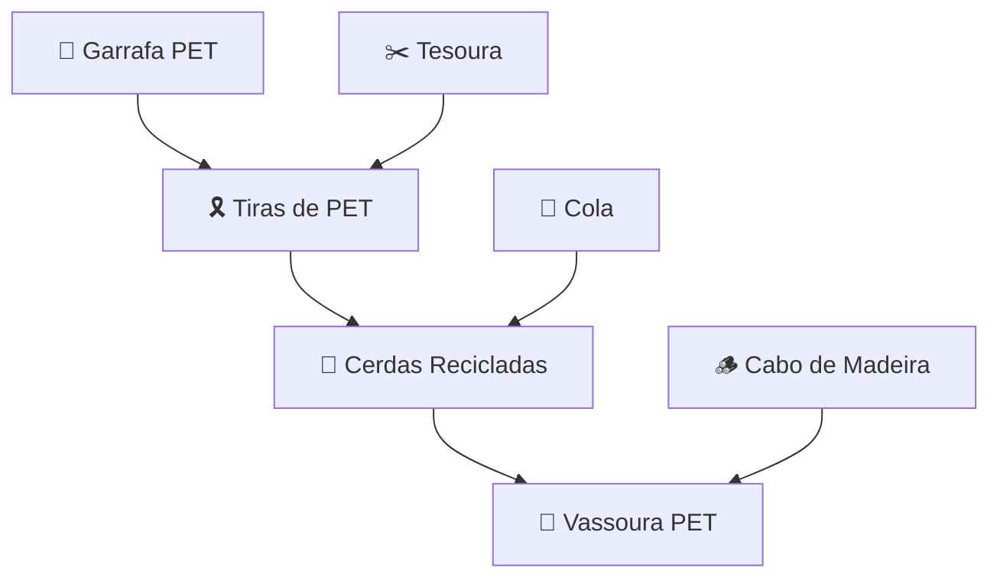
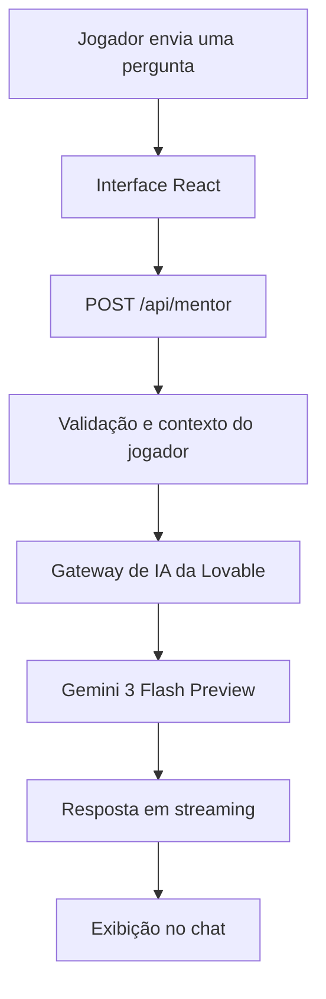

# ♻️ RECraft — Descubra, Transforme e Reutilize

### Um jogo educativo sobre sustentabilidade, criatividade e economia circular.

<p align="center">
  <strong>Transforme resíduos em recursos. Descubra novas possibilidades para o planeta!</strong>
</p>

<p align="center">
  <a href="https://recraft-unifacs.lovable.app">
    
  </a>
</p>

<p align="center">
  
  
  
  
  
</p>

---

## 🌱 Sobre o projeto

O **RECraft** é um jogo educativo interativo que ensina conceitos de sustentabilidade, reutilização de materiais e economia circular por meio de uma experiência de descoberta e criação.

A proposta é transformar o aprendizado ambiental em uma atividade prática e divertida: o jogador recebe resíduos e ferramentas, combina diferentes elementos e descobre novos materiais, componentes e objetos que podem ser produzidos a partir de itens que normalmente seriam descartados.

Em vez de apenas apresentar informações sobre reciclagem, o jogo incentiva o jogador a experimentar, formular hipóteses, resolver problemas e compreender como materiais aparentemente sem utilidade podem ganhar uma nova vida.

Além das mecânicas de combinação, o RECraft incorpora informações educativas, tutoriais de construção, dicas progressivas, conquistas e um Mentor Ecológico baseado em inteligência artificial.

**Jogue:** https://recraft-unifacs.lovable.app

## 🎯 Objetivos

- Incentivar a consciência ambiental por meio da gamificação.
- Demonstrar possibilidades de reutilização de resíduos cotidianos.
- Ensinar conceitos de economia circular de maneira interativa.
- Estimular criatividade, raciocínio lógico e resolução de problemas.
- Aproximar conhecimentos teóricos de aplicações práticas.
- Promover a aprendizagem autônoma com auxílio de inteligência artificial.

## 🎮 Como funciona o jogo?

O jogador começa com um inventário de resíduos e ferramentas. Na bancada de criação, pode arrastar elementos e combiná-los para descobrir novos materiais e objetos.

Cada descoberta amplia o inventário e desbloqueia novas possibilidades de combinação.

<details>
<summary><strong>Exemplo de uma sequência de descoberta</strong></summary>

1. O jogador seleciona uma Garrafa PET.
2. Combina a garrafa com uma Tesoura.
3. Descobre Tiras de PET.
4. Combina as tiras com Cola.
5. Descobre Cerdas Recicladas.
6. Combina as cerdas com um Cabo de Madeira.
7. Descobre uma Vassoura PET.



</details>

## ✨ Funcionalidades

### 1. 🧩 Bancada interativa de criação

O ambiente principal do jogo funciona como uma bancada virtual na qual o jogador pode experimentar combinações.

- Arrastar elementos do inventário para a bancada.
- Movimentar elementos já posicionados.
- Combinar dois elementos para produzir novos itens.
- Identificar combinações válidas e inválidas.
- Visualizar animações de descoberta.
- Consultar informações dos elementos com duplo clique.
- Remover elementos da bancada ao arrastá-los para fora.
- Limpar a bancada para começar novas experiências.

O sistema utiliza uma base de receitas definida no código, com busca de combinações independente da ordem dos ingredientes.

### 2. 🧺 Inventário de materiais

O inventário reúne os elementos disponíveis para criação e é atualizado conforme o jogador realiza descobertas.

Os elementos são organizados em quatro categorias:

| Categoria | Exemplos |
|---|---|
| Resíduos | Garrafa PET, jornal, papelão, lata e pneu |
| Ferramentas | Tesoura, cola, tinta, cabo de madeira, barbante e tecido |
| Componentes | Tiras de PET, papel machê e estruturas reutilizadas |
| Objetos finais | Vassoura PET, vaso decorativo, horta vertical e outros |

**Recursos adicionais:**
- Pesquisa por nome dos elementos.
- Organização por categoria.
- Atualização automática após novas descobertas.
- Inventário inicial com resíduos e ferramentas disponíveis desde o começo.

### 3. 📖 Catálogo de descobertas

O catálogo permite acompanhar os elementos existentes no universo do RECraft.

- Visualização dos elementos descobertos.
- Identificação de itens ainda bloqueados.
- Filtros por resíduos, ferramentas, componentes e objetos finais.
- Pesquisa por nome, categoria e materiais.
- Lista de favoritos.
- Indicadores de progresso.
- Acesso aos detalhes e tutoriais dos itens conhecidos.
- Solicitação de dicas para elementos ainda não descobertos.

### 4. 🌍 Informações ambientais e tutoriais

Cada objeto possui informações educativas que ajudam a conectar a experiência virtual com situações do cotidiano.

Dependendo do elemento, o jogador pode consultar:

- Materiais utilizados na construção.
- Benefícios ambientais.
- Aplicações práticas.
- Curiosidades sobre os materiais.
- Explicações educativas.
- Tutoriais com instruções passo a passo.
- Indicadores de impacto ambiental representados no jogo.

O objetivo é demonstrar não apenas que determinado objeto pode ser criado, mas também como sua produção pode contribuir para o reaproveitamento de materiais.

### 5. 💡 Sistema de dicas progressivas

O jogo possui um sistema de dicas para ajudar na descoberta de combinações ainda desconhecidas.

Cada elemento pode oferecer até três níveis de dicas:

| Nível | Característica |
|---|---|
| Nível 1 | Dica geral sobre a finalidade do objeto |
| Nível 2 | Orientação sobre o material ou sua origem |
| Nível 3 | Indicação mais específica dos ingredientes |

O sistema também contabiliza a utilização de dicas, relacionando-as à progressão e às conquistas do jogador.

Há ainda uma opção de **dica aleatória**, que seleciona um elemento ainda não descoberto.

### 6. 🏆 Sistema de conquistas e gamificação

O RECraft incorpora conquistas para incentivar a exploração e recompensar o progresso.

As conquistas estão divididas em cinco categorias:

- **Descoberta:** recompensa a exploração de novas combinações.
- **Sustentabilidade:** reconhece o reaproveitamento virtual de resíduos.
- **Conhecimento:** incentiva a leitura dos tutoriais.
- **Progressão:** acompanha o desenvolvimento do jogador.
- **Especiais:** recompensa desafios específicos, como descobrir objetos sem utilizar dicas.

O sistema também contempla:

- Diferentes níveis de raridade.
- Conquistas ocultas.
- Notificações de novas conquistas.
- Indicadores de progresso.
- Estatísticas individuais.

### 7. 🤖 Mentor Ecológico com inteligência artificial

Um dos recursos centrais do RECraft é o Mentor Ecológico, um assistente conversacional que ajuda o jogador durante sua jornada.

O mentor utiliza inteligência artificial para responder perguntas e fornecer orientações contextualizadas.

**Principais possibilidades:**

- Solicitar dicas sobre novas combinações.
- Aprender conceitos de sustentabilidade.
- Compreender os benefícios da reutilização.
- Receber sugestões criativas.
- Consultar curiosidades ambientais.
- Obter orientações relacionadas ao progresso no jogo.

O assistente recebe informações sobre os elementos descobertos, os itens ainda desconhecidos e as estatísticas do jogador.

**Tecnologia de IA:** integração com o gateway da Lovable, utilizando o modelo `google/gemini-3-flash-preview`, com respostas transmitidas em streaming.

O mentor possui instruções específicas para fornecer dicas pedagógicas progressivas, incentivar a curiosidade e evitar revelar receitas imediatamente, salvo quando solicitado de acordo com as regras do jogo.

---

## 🧠 Lógica de funcionamento

O jogo possui uma base própria de elementos, receitas e conquistas.

### Sistema de combinações

As receitas são armazenadas em `src/lib/recraft-data.ts`.

Cada receita associa dois ingredientes a um resultado:

```typescript
{
  inputs: ["garrafa_pet", "tesoura"],
  output: "tiras_pet"
}
```

A função `findRecipe()` procura uma combinação válida sem depender da ordem dos ingredientes.

Quando uma combinação é realizada:

1. O sistema verifica se existe uma receita correspondente.
2. Caso não exista, registra uma tentativa inválida.
3. Caso exista, verifica se o resultado já foi descoberto.
4. Se for uma nova descoberta, atualiza o progresso.
5. O sistema gera uma notificação.
6. As condições de conquistas são verificadas.

### Persistência do progresso

O gerenciamento de estado é realizado com Zustand, utilizando o middleware `persist`.

O jogo armazena informações como:

- Elementos descobertos.
- Favoritos.
- Dicas utilizadas.
- Tutoriais lidos.
- Curiosidades consultadas.
- Combinações realizadas.
- Tentativas inválidas.
- Conquistas desbloqueadas.

O armazenamento é feito localmente no navegador, permitindo manter o progresso entre sessões no mesmo ambiente.

### Integração com inteligência artificial

A comunicação com o Mentor Ecológico ocorre por meio da rota:

```text
POST /api/mentor
```

O fluxo é:



A chave de acesso é utilizada no servidor, não diretamente no código da interface.

---

## 🛠️ Tecnologias utilizadas

| Tecnologia | Aplicação |
|---|---|
| React 19 | Construção da interface |
| TypeScript | Tipagem e organização do código |
| Vite 7 | Desenvolvimento e build |
| TanStack Start | Estrutura da aplicação e rotas de servidor |
| TanStack Router | Navegação e roteamento |
| TanStack React Query | Gerenciamento de consultas |
| Zustand | Gerenciamento e persistência de estado |
| Tailwind CSS 4 | Estilização |
| Radix UI | Componentes acessíveis |
| shadcn/ui | Base de componentes visuais |
| Lucide React | Ícones |
| React Markdown | Renderização das respostas do mentor |
| Zod | Validação de dados |
| Gemini 3 Flash Preview | Inteligência artificial do mentor |
| Lovable AI Gateway | Comunicação com o modelo de IA |
| Bun | Gerenciamento de dependências |

## 🏗️ Estrutura do projeto

```text
recraft/
│
├── public/
│   └── favicon.ico
│
├── src/
│   │
│   ├── components/
│   │   ├── recraft/
│   │   │   ├── AchievementsDialog.tsx
│   │   │   ├── AiMentorDialog.tsx
│   │   │   ├── CatalogDialog.tsx
│   │   │   ├── ElementChip.tsx
│   │   │   ├── HintDialog.tsx
│   │   │   └── ItemDetailDialog.tsx
│   │   │
│   │   └── ui/
│   │       └── Componentes reutilizáveis
│   │
│   ├── hooks/
│   │   └── use-mobile.tsx
│   │
│   ├── lib/
│   │   ├── api/
│   │   │   └── example.functions.ts
│   │   ├── config.server.ts
│   │   ├── error-capture.ts
│   │   ├── error-page.ts
│   │   ├── lovable-error-reporting.ts
│   │   ├── recraft-data.ts
│   │   ├── recraft-store.ts
│   │   └── utils.ts
│   │
│   ├── routes/
│   │   ├── api/
│   │   │   └── mentor.ts
│   │   ├── __root.tsx
│   │   ├── index.tsx
│   │   └── README.md
│   │
│   ├── routeTree.gen.ts
│   ├── router.tsx
│   ├── server.ts
│   ├── start.ts
│   └── styles.css
│
├── .lovable/
├── .gitignore
├── bun.lock
├── bunfig.toml
├── components.json
├── eslint.config.js
├── package.json
├── tsconfig.json
└── vite.config.ts
```

### Principais arquivos

| Arquivo | Responsabilidade |
|---|---|
| `src/routes/index.tsx` | Tela principal e mecânicas da bancada |
| `src/lib/recraft-data.ts` | Elementos, receitas e conquistas |
| `src/lib/recraft-store.ts` | Estado, progresso e persistência |
| `src/components/recraft/AiMentorDialog.tsx` | Interface do Mentor Ecológico |
| `src/routes/api/mentor.ts` | Integração de servidor com a IA |
| `src/components/recraft/CatalogDialog.tsx` | Catálogo de elementos |
| `src/components/recraft/AchievementsDialog.tsx` | Sistema de conquistas |
| `src/components/recraft/HintDialog.tsx` | Sistema de dicas |
| `src/components/recraft/ItemDetailDialog.tsx` | Informações e tutoriais dos elementos |

---

## 🚀 Como executar localmente

### Pré-requisitos

- [Bun](https://bun.sh/) instalado.
- Git instalado.
- Conexão com a internet para instalar as dependências e utilizar o Mentor Ecológico.

### 1. Clone o repositório

```bash
git clone https://github.com/Gloterianota349/recraft.git
```

### 2. Acesse a pasta

```bash
cd recraft
```

### 3. Instale as dependências

```bash
bun install
```

### 4. Configure a integração de IA

Para utilizar o Mentor Ecológico, configure a variável de ambiente `LOVABLE_API_KEY` no ambiente de execução do servidor.

Crie um arquivo `.env` na raiz do projeto:

```env
LOVABLE_API_KEY=sua_chave_de_acesso
```

Substitua o valor pelo segredo válido disponibilizado para seu ambiente de execução.

**Importante:** não compartilhe essa chave, não a envie ao GitHub e não utilize o prefixo `VITE_` para essa variável. Ela deve permanecer exclusivamente no servidor.

Sem essa configuração, o jogo poderá ser utilizado, mas o Mentor Ecológico não conseguirá realizar chamadas ao serviço de IA.

### 5. Execute o projeto

```bash
bun run dev
```

O Vite exibirá no terminal o endereço local para acessar a aplicação.

### 6. Gere a versão de produção

```bash
bun run build
```

### 7. Visualize a versão de produção

```bash
bun run preview
```

---

## 🔭 Possíveis evoluções

Algumas possibilidades para ampliar o projeto:

- [ ] Sistema de contas e perfis individuais.
- [ ] Sincronização de progresso entre dispositivos.
- [ ] Novos resíduos, ferramentas e receitas.
- [ ] Editor para criação de novas receitas.
- [ ] Mais desafios e missões temáticas.
- [ ] Sistema de pontuação e classificação entre jogadores.
- [ ] Modo multiplayer e desafios colaborativos.
- [ ] Novas atividades educativas para escolas.
- [ ] Painel de acompanhamento para professores.
- [ ] Expansão do catálogo com mais objetos e tutoriais.
- [ ] Integração com fontes externas de conteúdo ambiental.
- [ ] Testes automatizados das mecânicas e da integração com IA.

## 👨‍💻 Autor

**Guilherme Andrade**

- GitHub: [@Gloterianota349](https://github.com/Gloterianota349)

---

<p align="center">
  <strong>♻️ RECraft — Descubra, transforme e reutilize.</strong>
  <br>
  <em>O futuro sustentável começa com novas ideias.</em>
</p>
